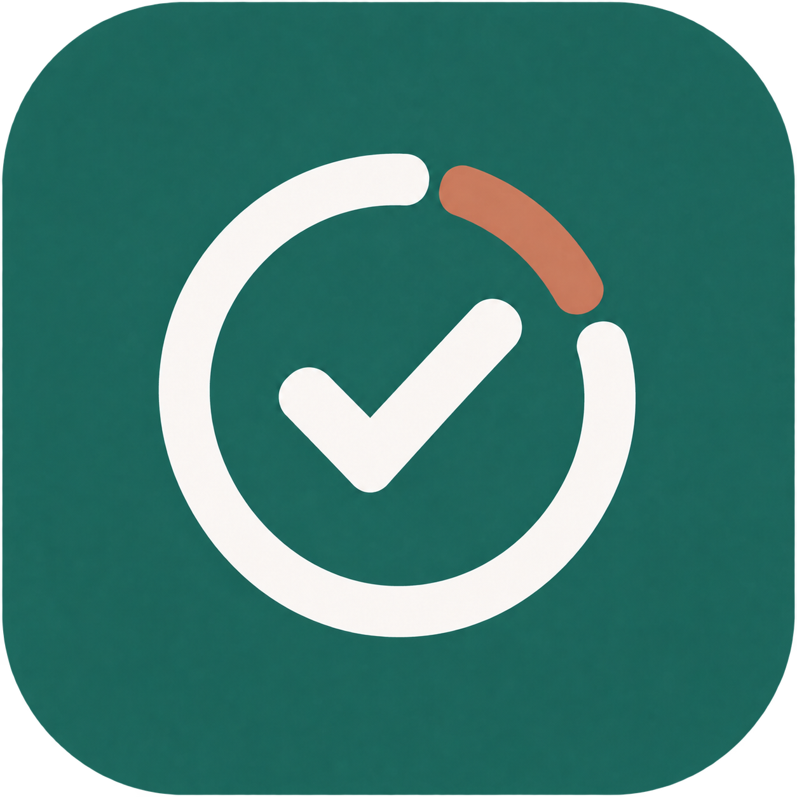

<p align="center">
  
</p>

<h1 align="center">Doro List</h1>

Aplicativo Flutter de lista de tarefas e Pomodoro, sem conta ou backend.

- Tarefas: criação, edição, conclusão, exclusão e desfazer a última exclusão.
- Filtros de todas, pendentes e concluídas, ordenação por arrastar e limpeza das concluídas.
- Vínculo entre tarefa e Pomodoro, com escolha na lista ou na aba Foco.
- Resumo diário de tarefas concluídas, sessões concluídas e tempo de foco.
- Backup de tarefas por exportação/importação de arquivos JSON.
- Recuperação do temporizador após fechar e abrir o app.
- Avisos locais de término, com som e vibração conforme as permissões e o sistema.
- Persistência local em `todos.json`, na pasta de documentos do aplicativo.
- Pomodoro configurável: foco, pausas curta e longa e sessões antes da pausa longa.
- Padrão de 25 / 5 / 15 minutos, com pausa longa após 4 sessões de foco.
- A próxima etapa aguarda Iniciar por padrão; avanço automático é opcional.
- Preferências salvas localmente em `pomodoro_settings.json`.
- Pausa, continuação e reinício do temporizador, com correção ao retomar o app.
- Seletor de tema em **Resumo → Tema**, com as opções Sistema (padrão),
  Claro e Escuro. A opção Sistema acompanha a aparência do dispositivo.
- Interface Cupertino no iOS e Material Design no Android e desktop, com a mesma
  paleta e os mesmos dados. No iOS, a navegação usa abas e rotas Cupertino,
  configurações usam seletores em roleta, e as mensagens temporárias têm ação
  de desfazer e fechamento automático em 5 segundos.
- Tela Sobre o app acessível pelo ícone de informação na aba Resumo, com versão
  instalada e crédito com link para o portfólio de Anthony Oliveira.

## Executar

Com Flutter e as ferramentas da plataforma instalados:

```sh
flutter pub get
flutter run -d macos
```

Para outros dispositivos, consulte `flutter devices` e substitua `macos`.

No iOS, os plugins são resolvidos exclusivamente pelo Swift Package Manager
durante o build do Flutter. Para trabalhar no Xcode, abra `ios/Runner.xcworkspace`.
Se a integração Swift Package Manager estiver com referências temporárias antigas:

```sh
flutter clean
flutter pub get
flutter run -d macos
```

## Build Android

A configuração Android usa Gradle 9.3.1, Android Gradle Plugin 9.1.1 e Kotlin 2.4.0,
alinhados ao Flutter 3.47. O código Java/Kotlin é compilado para JVM 17.
Essa configuração permite executar o Gradle com o Java 25 fornecido pelo
Android Studio instalado neste ambiente.

Para gerar um APK de desenvolvimento:

```sh
flutter pub get
flutter build apk --debug
```

O APK é gerado em `build/app/outputs/flutter-apk/app-debug.apk`.

## Organização

O ícone do iOS usa o arquivo `ios/Runner/DoroList.icon`, editável no Icon Composer
e compilado pelo Xcode. Para atualizar o Liquid Glass, substitua esse pacote
mantendo o nome `DoroList.icon`. O `flutter_launcher_icons` está desativado para
iOS para preservar essa configuração; continua gerando os ícones das outras
plataformas.

A splash nativa usa `assets/doro-splash.png` (logo transparente) e
`assets/doro-splash-android12.png` (área segura do Android 12+), com fundo verde
nas aparências clara e escura. Após alterar a seção `flutter_native_splash` do
`pubspec.yaml`, execute `dart run flutter_native_splash:create` e gere uma nova
build para atualizar a tela de abertura no dispositivo.

## Arquitetura MVVM

- **View** (`lib/pages` e `lib/components`) renderiza o estado dos ViewModels e encaminha ações. Navegação, foco de campos e apresentação de diálogos ficam na interface.
- **ViewModel** (`lib/view_models`) coordena tarefas, cronômetro, resumo, configurações, tema e informações do app. As Views observam mudanças com `ListenableBuilder` ou exibem resultados assíncronos com `FutureBuilder`.
- **Model** (`lib/models`, `lib/repositories` e `lib/services`) representa e persiste os dados, além de integrar backups, notificações e recursos do sistema.
- `lib/app/productivity_scope.dart` cria e conecta as dependências compartilhadas pelas abas. Os imports antigos em `lib/controllers` encaminham para as classes atuais.

## Configurar o Pomodoro

Na aba Foco, use o ícone de ajustes no topo. Os seletores oferecem foco de 5 a 180
minutos, pausa curta de 5 a 60 e pausa longa de 5 a 90, sempre de 5 em 5 minutos.
O seletor de sessões permite ciclos de 1 a 30 sessões.
As configurações ficam disponíveis quando o temporizador está parado ou pausado.
Salvar configurações começa um novo ciclo. Restaurar padrão preenche os valores
originais; use Salvar configurações para confirmar.

Apenas sessões de foco concluídas contam para a pausa longa. Após a pausa curta,
o app prepara o foco novamente; após a pausa longa, também reinicia o contador.
O tempo avulso de Definir tempo não conta no ciclo. No modo automático, ao retomar
o app após suspensão, a próxima etapa começa naquele momento, sem contabilizar
sessões adicionais durante a suspensão.

## Tarefas e backup

Na lista, use o botão de reprodução de uma tarefa pendente para abrir o Pomodoro
vinculado a ela. Na aba Foco, também é possível escolher uma tarefa ou focar sem
vínculo. Para trocar de tarefa durante uma sessão já iniciada, reinicie a sessão.
Concluir um Pomodoro não marca a tarefa automaticamente como concluída.

Use os filtros Todas, Pendentes e Concluídas. Arraste pela alça à direita para
mudar a ordem dentro do grupo; tarefas pendentes continuam antes das concluídas.
No menu Mais opções ficam Resumo do dia, Exportar tarefas, Importar tarefas e
Limpar concluídas. Limpar e importar pedem confirmação.

O backup é um JSON de tarefas, incluindo ordem e estado de conclusão. A importação
adiciona IDs novos, mantém as tarefas existentes e ignora IDs já presentes. Ela
não substitui títulos existentes nem importa o histórico de foco ou configurações.
Arquivos inválidos, com IDs duplicados ou maiores que 5 MB são recusados antes da
importação. O seletor de arquivos do sistema permite escolher onde salvar e abrir.

## Histórico, recuperação e avisos

O arquivo local `activity.json` guarda o histórico e a sessão ativa. Somente
Pomodoros concluídos entram no total de sessões e minutos; pausas e temporizadores
avulsos não contam. O resumo usa a data local do término da sessão. Limpar ou
excluir tarefas não remove esse histórico. Desmarcar uma conclusão do dia retira
a tarefa do total daquele dia, sem duplicar contagens ao marcar novamente.

Ao reabrir o app, sessões em andamento usam o horário de término para recuperar
o tempo restante. Sessões pausadas mantêm o tempo. Se a sessão terminou enquanto
o app estava fechado, ela é registrada uma única vez e a próxima etapa aguarda
Iniciar, mesmo no modo automático, sem inventar ciclos durante o período fechado.

O primeiro início de sessão solicita autorização de notificações. No Android,
alarmes exatos dependem de uma permissão adicional do sistema; sem ela, o aviso
em segundo plano pode atrasar. Pausar, reiniciar ou trocar a duração cancela o
aviso anterior. Android, iOS e macOS agendam o aviso no sistema, para funcionar
sem o aplicativo aberto. Som e vibração respeitam permissões, modo silencioso,
configurações do aparelho e disponibilidade de hardware. Linux e Windows usam
apenas o aviso em primeiro plano. Tocar numa notificação abre a aba Foco.

## Verificação

```sh
flutter analyze
flutter test
```

## Limitações

Os dados ficam apenas no dispositivo, sem sincronização ou backup automático.
O backup manual inclui apenas tarefas. Encerramento forçado e restrições de
bateria do sistema podem impedir avisos, especialmente no Android. A persistência
usa `dart:io`; a versão web precisa de outra implementação de armazenamento.

Antes de publicar no Android, configure o identificador do aplicativo e a assinatura
de release em `android/app/build.gradle`, que ainda utiliza a assinatura de debug.

## Live Activity no iOS

A partir do iOS 16.1, iniciar uma sessão exibe fase, tarefa e contagem na tela
bloqueada e na Dynamic Island dos aparelhos compatíveis. O iOS pode solicitar
que o usuário permita Atividades ao Vivo. Pausar congela o tempo; continuar
atualiza o término; reiniciar ou concluir encerra a atividade. Tocar nela abre Foco.
O iOS 15 e as outras plataformas continuam usando o cronômetro e os avisos locais.

A extensão `PomodoroLiveActivity` usa SwiftUI e ActivityKit. O Flutter envia
mudanças por `doro_list/pomodoro_live_activity`; a contagem usa o horário de término
nativo, sem atualizações por segundo nem servidor. A extensão compartilha o modelo
em `ios/Shared/PomodoroActivityAttributes.swift` e acompanha a versão do Flutter.
Para rodar em aparelho ou distribuir, use a mesma equipe de assinatura no Runner
e na extensão; se mudar o bundle ID, ajuste também o ID da extensão com o mesmo prefixo.

Com o processo suspenso, o sistema continua desenhando a contagem até zero.
O término não garante execução do Dart: a notificação local permanece responsável
pelo aviso, e as transições/sincronização ocorrem quando o app pode executar.
No iOS 16.2+, `staleDate` também permite exibir “Etapa concluída” no conteúdo vencido;
ela não encerra sozinha a atividade nem inicia automaticamente outra etapa.
O link `doro-list://focus` é tratado pelo SceneDelegate, incluindo abertura a frio.

## Notificação de andamento no Android

Ao iniciar uma sessão, o Android exibe uma notificação silenciosa com fase,
tarefa e contagem regressiva nativa. Na pausa, mostra o tempo congelado.
Tocar na notificação abre Foco; Pausar e Continuar também abrem essa aba e
aplicam a ação após recuperar a sessão, sem afetar sessões diferentes.
A notificação é removida ao reiniciar ou concluir a sessão, e expira no horário
de término mesmo se o processo estiver fechado. O aviso sonoro de término
continua sendo uma notificação local separada, com as permissões já existentes.

O canal “Pomodoro em andamento” pode ser controlado nos ajustes do Android.
O recurso usa notificações padrão e não exige um serviço em primeiro plano
nem atualizações do Flutter por segundo. A aparência na tela bloqueada segue
as configurações de privacidade do aparelho. Esta implementação não solicita
promoção para Live Updates/status chips de fabricantes específicos.
